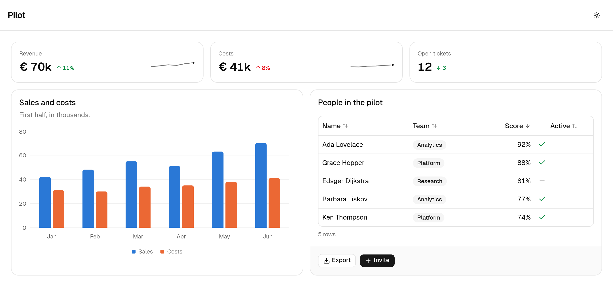

<p align="center"></p>

<h1 align="center">millwork</h1>

<p align="center">A modern UI framework for Python</p>

<p align="center">
  <a href="https://github.com/DvGils/millwork/actions/workflows/ci.yml"></a>
  
  
</p>

<picture>
  <source media="(prefers-color-scheme: dark)" srcset=".github/readme/app-dark.png">
  
</picture>

A page is a Python function of the session's state. A handler changes the
state, the page renders again, and the browser receives a patch. The React bundle
ships inside the package, so a project is Python only.

```python
import millwork as mw
from millwork import ui
from pydantic import BaseModel


class State(BaseModel):
    clicks: int = 0


app = mw.App("hello", state=State)


@app.page("/")
def home(s: mw.Session[State]) -> ui.Component:
    return ui.Page(
        ui.Text(f"Clicked {s.state.clicks} times."),
        ui.Button("Add one", on_click=lambda s, _: setattr(s.state, "clicks", s.state.clicks + 1)),
    )
```

```bash
uv add millwork  # or `pip install millwork`
uv run millwork run app.py
```

A whole page is the same loop with more in it. This is the page in the
screenshot: a row of stats, a chart in a card, and a table whose selection
lives in the state.

```python
import millwork as mw
from millwork import ui
from pydantic import BaseModel

MONTHS = [
    {"month": "May", "revenue": 52, "costs": 31},
    {"month": "Jun", "revenue": 48, "costs": 30},
    {"month": "Jul", "revenue": 55, "costs": 34},
    {"month": "Aug", "revenue": 51, "costs": 35},
    {"month": "Sep", "revenue": 63, "costs": 38},
    {"month": "Oct", "revenue": 70, "costs": 41},
]

ORDERS = [
    {"id": 1041, "customer": "Lumen Labs", "amount": 1200.0, "status": "paid"},
    {"id": 1042, "customer": "Wren & Co", "amount": 840.0, "status": "open"},
    {"id": 1043, "customer": "Halvard", "amount": 2310.0, "status": "paid"},
    {"id": 1044, "customer": "Pell Street", "amount": 460.0, "status": "overdue"},
]


class State(BaseModel):
    selected: list[int] = []


app = mw.App("ledger", state=State)


def pick(s: mw.Session[State], keys: list[int]) -> None:
    s.state.selected = keys


@app.page("/", title="Ledger")
def home(s: mw.Session[State]) -> ui.Component:
    chosen = [o for o in ORDERS if o["id"] in s.state.selected]
    return ui.Page(
        ui.Stack(
            ui.Grid(
                ui.Stat(label="Revenue", value="€ 70k", delta=0.11, trend=[52, 48, 55, 51, 63, 70]),
                ui.Stat(label="Costs", value="€ 41k", delta=0.08, good="down", trend=[31, 30, 34, 35, 38, 41]),
                ui.Stat(label="Open orders", value=str(sum(o["status"] != "paid" for o in ORDERS))),
                cols={"sm": 1, "md": 3},
            ),
            ui.Card(
                ui.BarChart(MONTHS, x="month", y=["revenue", "costs"], height=220),
                title="Revenue and costs",
                description="Thousands of euros, by month.",
            ),
            ui.Card(
                ui.Table(
                    rows=ORDERS,
                    columns=[
                        ui.Column(key="id", header="Order"),
                        ui.Column(key="customer"),
                        ui.Column(key="amount", format="currency", align="right"),
                        ui.Column(key="status", format="badge"),
                    ],
                    selection="rows",
                    selected=s.state.selected,
                    on_select=pick,
                ),
                title="Orders",
                footer=ui.Text(f"{len(chosen)} selected", variant="muted"),
            ),
            gap=6,
        ),
        header=ui.Header(title="Ledger"),
    )
```

## What is in the box

- **A catalog of components** on shadcn/ui: layout, text, inputs,
  feedback, tables, charts, forms from Pydantic models, files, tasks with
  progress, and a chat surface that streams replies from Python.
- **One model of state.** Python owns the state; a control is owned by
  Python or by the browser, and the page says which.
- **Long work as tasks**, with progress, steps and cancellation drawn by
  the page, and chat replies that stream text, reasoning and tool steps.
- **Files over the session's socket.** Uploads, downloads and inline
  images travel on the same connection as everything else, so replicas
  need no sticky routing and no shared storage.
- **Sign-in** with password, OAuth and proxy-header providers behind one
  `on_login` hook, and a theme file in the shadcn token vocabulary for
  colors, fonts and logos.
- **A test harness** that drives a page without a browser: open it,
  click, change, submit, and read what the tab would have received.
- **One process to run.** `millwork run` serves an app on a port or a
  unix socket, behind a proxy and under a path prefix, with a health
  route for the host.

## The manual

The manual is at [millwork-ui.com](https://millwork-ui.com). It is a
millwork app: every example in it runs, with the Python code beside it.
The chapters cover pages and routing, state and handlers, signing in,
theming, testing and running, and every component has a live example. It
also runs locally:

```
uv run millwork docs
```

Then open http://127.0.0.1:8008.

`millwork reference` prints the catalog as one Markdown table of every
component, its props with their types and defaults, the session's and the
app's calls, the icon names, the form widgets and the formats. The hosted
manual serves the same text at
[millwork-ui.com/llms.txt](https://millwork-ui.com/llms.txt), for a model
that needs a lookup rather than a chapter.

## Status

millwork is still in beta.

## Developing millwork

Python is managed with uv, the bundle with pnpm; only `bundle/` needs
Node.

```
uv run pytest -q                       # the Python suite
uv run mypy src && uv run ruff check src tests
pnpm -C bundle exec tsc -b             # the bundle's types
CI=1 pnpm -C bundle exec vitest run    # the bundle's unit tests
CI=1 pnpm -C bundle build              # rebuilds src/millwork/_bundle/dist
```

Dependencies wait two weeks. `tool.uv` in `pyproject.toml` and the bundle's
`pnpm-workspace.yaml` resolve only versions that have been on their index
for fourteen days, and Dependabot proposes a bump on the same schedule.
Dependabot's alerts watch the lockfiles for known vulnerabilities; before
a release, the same question is asked by hand:

```
uv export --format requirements-txt --no-emit-project -q -o requirements.txt
uvx pip-audit -r requirements.txt --no-deps
pnpm -C bundle audit
```

A change to a component's fields is followed by `uv run python
scripts/typed_inits.py`, which rewrites the typed signature under each
class that mypy and pyright read, and a test checks that it was run.

A change to the bundle is committed together with the rebuilt `dist`, so
every checkout runs without Node. That includes a Dependabot bump of the
bundle's packages: apply it, rebuild, look at the manual, and commit the
`dist` with it, or CI refuses the branch. The manual's pages under
`src/millwork/manual/pages` are the gallery a bundle upgrade is judged
against.

## Releasing

A release is a tag. Write the version's section in `CHANGELOG.md`, set the
version with `uv version`, commit, tag it `v` plus the version and push the
tag. The release workflow waits for approval, checks the tagged commit,
builds the wheel, publishes it to PyPI and makes the GitHub release from
the changelog section. The published release then deploys the hosted
manual from that version on PyPI; `deploy/` holds its image and Fly
configuration. To deploy one by hand, put the release's wheel next to the
image with `gh release download v<version> --pattern "millwork-*.whl" --dir
deploy`, then `flyctl deploy ./deploy`.

## License

Apache-2.0.
