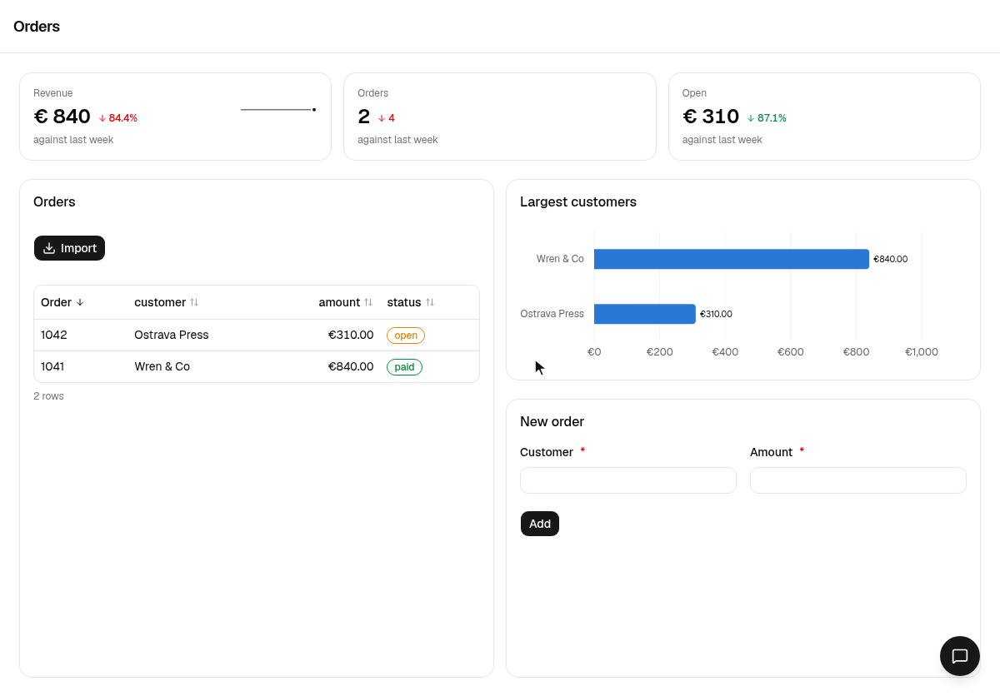

<p align="center"></p>

<h1 align="center">millwork</h1>

<p align="center">A modern UI framework for Python</p>

<p align="center">
  <a href="https://github.com/DvGils/millwork/actions/workflows/ci.yml"></a>
  
  
</p>



A page is a Python function of the session's state. A handler changes the
state, the page renders again, and the browser receives a patch. The React bundle
ships inside the package, so a project is Python only.

```python
import millwork as mw
from millwork import ui
from pydantic import BaseModel


class State(BaseModel):
    clicks: int = 0


app = mw.App("hello", state=State)


@app.page("/")
def home(s: mw.Session[State]) -> ui.Component:
    return ui.Page(
        ui.Text(f"Clicked {s.state.clicks} times."),
        ui.Button("Add one", on_click=lambda s, _: setattr(s.state, "clicks", s.state.clicks + 1)),
    )
```

## Installation


```bash
uv add millwork  # or `pip install millwork`
uv run millwork run app.py
```

## What is included

- **A catalog of components** on shadcn/ui: layout, text, inputs,
  feedback, tables, charts, forms from Pydantic models, files, tasks with
  progress, and a chat surface that streams replies from Python.
- **One model of state.** Python owns the state; a control is owned by
  Python or by the browser, and the page says which.
- **Long work as tasks**, with progress, steps and cancellation drawn by
  the page, and chat replies that stream text, reasoning and tool steps.
- **Files over the session's socket.** Uploads, downloads and inline
  images travel on the same connection as everything else, so replicas
  need no sticky routing and no shared storage.
- **Sign-in** with password, OAuth and proxy-header providers behind one
  `on_login` hook, and a theme file in the shadcn token vocabulary for
  colors, fonts and logos.
- **A test harness** that drives a page without a browser: open it,
  click, change, submit, and read what the tab would have received.
- **One process to run.** `millwork run` serves an app on a port or a
  unix socket, behind a proxy and under a path prefix, with a health
  route for the host.

## The manual

The manual is at [millwork-ui.com](https://millwork-ui.com).  

The manual itself is a millwork app. Every example in it runs, with the Python code beside it.
The chapters cover pages and routing, state and handlers, signing in,
theming, testing and running, and every component has a live example. It
also runs locally:

```
uv run millwork docs
```

Then open http://127.0.0.1:8008.

`millwork reference` prints the catalog as one Markdown table of every
component, its props with their types and defaults, the session's and the
app's calls, the icon names, the form widgets and the formats. The hosted
manual serves the same text at
[millwork-ui.com/llms.txt](https://millwork-ui.com/llms.txt), for a model
that needs easy lookup.

## Status

millwork is still in beta.

## Contributing

Bug reports and fixes are welcome.
[CONTRIBUTING.md](https://github.com/DvGils/millwork/blob/main/CONTRIBUTING.md)
has the setup, the checks a change has to pass, and how to propose a
larger one.

## License

Apache-2.0.
