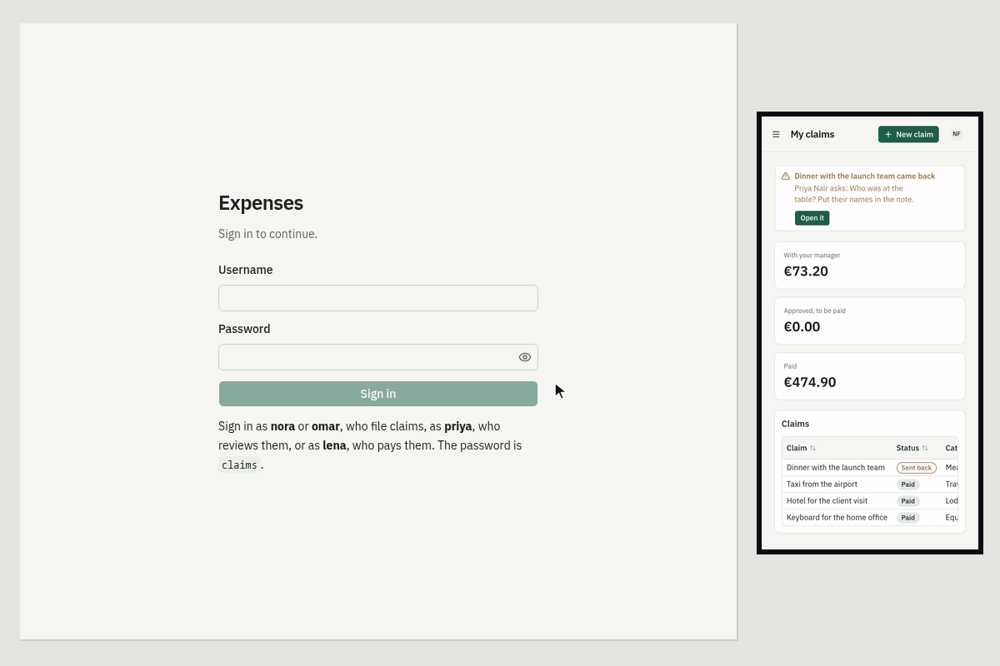

# Expense claims



Someone files a claim with its receipt, their manager approves it or
sends it back with a question, and finance pays what was approved and
prints the report. Each of the three signs in and finds an app of their
own, with the pages they may open and the buttons for what they can do.

```
uv run millwork run examples/claims/app.py
```

Open http://127.0.0.1:8000 and sign in as `nora` or `omar`, who file
claims, as `priya`, who reviews them, or as `lena`, who pays them. The
password is `claims`. A second browser, or a private window, is a second
person.

## What it shows

| In the app | Made with | In the manual |
|---|---|---|
| A login page with the app's own words on it | `auth.Auth(login=)` around `ui.SignIn("password")` | [The login page](https://millwork-ui.com/sign-in/login-page) |
| Who is signing in, and which role they have | `auth.Password`, and an `on_login` hook that puts the role in the user's claims | [Admitting users](https://millwork-ui.com/sign-in/admitting-users) |
| A page for some people only | `@app.page(..., allow=role("manager"))`, a rule about the user | [Access rules](https://millwork-ui.com/sign-in/access-rules) |
| A sidebar with the places this person can go | `s.can(path)` | [Access rules](https://millwork-ui.com/sign-in/access-rules#links-for-those-who-can-follow-them) |
| A claim that is someone else's is refused | `mw.Forbidden` from the page's `connect` hook, which takes a look at the claim | [Sessions](https://millwork-ui.com/pages/sessions#connect) |
| A form with a date, a choice, an amount and a file | `ui.Form` from one Pydantic model | [Forms](https://millwork-ui.com/components/form) |
| A claim without a receipt is refused, with the reason at the field | `ui.FormIssues` | [Rejecting a valid draft](https://millwork-ui.com/components/form#rejecting-a-valid-draft) |
| A question asked in the middle of a handler | `await s.ask(...)` with a form in a dialog | [Confirm and ask](https://millwork-ui.com/components/feedback#confirm-and-ask) |
| A receipt one person uploaded, in front of another | The claim keeps the bytes, and a route of the app's own serves them behind the sign-in | [Routes and middleware](https://millwork-ui.com/pages/routes-and-middleware) |
| The day a form opens on is today for the person filing | `s.timezone` | [The viewer's time zone](https://millwork-ui.com/pages/sessions#the-viewer-s-time-zone) |
| A list that follows what others do | One `mw.Signal` beside the claims | [Data that sessions share](https://millwork-ui.com/state/accessing-the-session#data-that-sessions-share) |
| The page on paper | `s.print()` | [Layout](https://millwork-ui.com/components/layout#page) |
| A look of its own, with the denser spacing of a tool | `public/theme.json` with `"density": "compact"` | [Theming](https://millwork-ui.com/theming) |

## The files

- `app.py` is who may see which page, the pages and the handlers.
- `claims.py` is what the company shares. That is the people, the
  claims and what happened to each one. It builds no page.
- `receipts/` holds a few pictures of receipts, for the claims the app
  starts with and for you to upload.
- `public/theme.json` is the look. The font is IBM Plex Sans, under the
  SIL Open Font License that lies beside it.
- `test_claims.py` drives the app without a browser, as each person.
- `record.py` makes the picture above.

## Who can do what

A page says who may open it with a rule, and a rule looks at the user
and at the parameters of the path. That is enough for `/mine`,
`/review`, `/team`, `/payments` and `/report`. Whether someone may see
one claim depends on whose claim it is, so the claim's page asks in its
`connect` hook and raises `mw.Forbidden`.

Inside a page, a button is drawn for the person who can use it, so
nobody is offered what they cannot do. That is for the eye, and it is
not the check. A page that was drawn a minute ago can be pressed after
the claim has changed, and a form in a sheet that is closed is on the
page all the same. So `claims.py` asks who is acting at every change.
`decide` is for the owner's manager while the claim waits, `send_again`
for the owner of a claim that was sent back, and `pay` for finance and
for what is approved. Each returns whether it did anything, and the
handler tells the person when it did not.

The report is one page for a manager and for finance. Each sees what
`Claims.seen_by` gives them, which is their own people's claims or
everyone's.

## A file for two people

An upload belongs to the session it came in on and ends with it. A
receipt has to outlive that, and to be seen by someone else. So when a
claim is filed the app reads the upload's bytes into the claim, and
gives the upload back. An upload that is chosen and never sent stays
with its session until that ends.

Whoever looks at the claim gets the picture from a route of the app's
own, `/receipts/{claim}/{digest}`. A route is behind the sign-in like a
page, and this one asks the claim whether the person may see it, as the
claim's page does. The address ends in a digest of the bytes, so a
receipt that is replaced has a new address, and a manager who had the
claim open sees the new picture and not the one she saw before. A
browser may keep the picture, and asks the route again each time before
it shows it.

What the receipt field takes, a picture of 5 MB at most, is said on the
model, with `json_schema_extra`. The server holds every upload to it,
also one that did not come through the form's own button.

## What it leaves out

Everything is kept in memory, so a restart empties it and signs
everyone out. There is one password for all four people, and nothing
counts the wrong ones. A real app keeps its claims and receipts in a
store, signs people in with the company's accounts or checks a hash of
each person's own password, slows down someone who keeps guessing, and
keeps a secret that outlives a restart.
