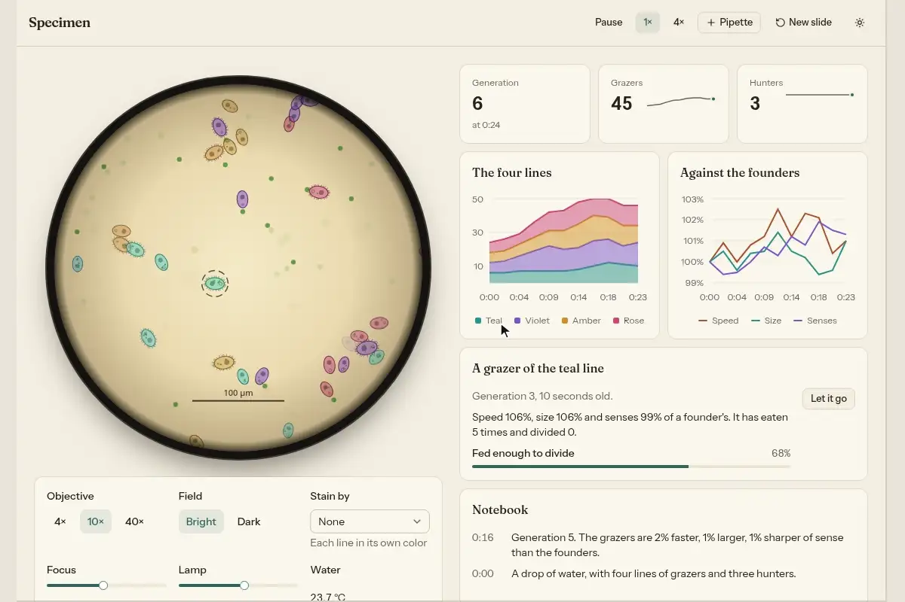

# Microscope



A drop of water in which cells eat, are eaten and divide. A daughter has
the speed, the size, the senses and the color of its parent, each a
little changed, so over the generations the cells become what the drop
asks of them. You look at it through a microscope, and the microscope is
part of it. The lamp shines on what is in view, algae grow in its light,
and life gathers where you look.

```
uv run millwork run examples/microscope/app.py
```

## What there is to do

- Drag the view to move the slide. The algae grow where you stop.
- Turn to another objective, with the buttons or with the wheel over
  the view. A stronger
  one shows less of the drop and puts the same light on it, so the algae
  grow thick there and the cells crowd in.
- Press a cell to follow it. The slide and the focus go with it, through
  its divisions, until it dies.
- Turn the focus. What lies above or below the depth in focus is a
  blur, the more so the stronger the objective.
- Turn the lamp up. More algae grow, and the water warms, which makes
  every cell faster and hungrier.
- Change to the dark field, or stain the cells by how fast they are, how
  well fed, or which generation they are of.
- Add grazers or hunters from the pipette, and see what the others
  become with them there.

The charts say what happened. One is how many grazers each of the four
founding lines has, and the other what the grazers have become against
the founders. How they turn out depends on how you looked. Under the
strongest objective the algae are thick in one small place, and the
grazers there get slower over the generations. Under the weakest they
are spread thin, and the grazers stay about as fast as they were.
Everywhere they get smaller, since a small cell needs less.

## What it shows

| In the app | Made with | In the manual |
|---|---|---|
| The view through the microscope | A component of the app's own on a canvas, `components/Scope.jsx`, given the cells as props | [Custom components](https://millwork-ui.com/components/custom) |
| Dragging, the wheel and a press on a cell | The component's `emit`, to handlers in Python | [Using it from Python](https://millwork-ui.com/components/custom#using-it-from-python) |
| A drop that goes on by itself | One clock for every drop, started with `app.spawn`, and a `mw.Signal` on each drop that its session follows | [Data that sessions share](https://millwork-ui.com/state/accessing-the-session#data-that-sessions-share) |
| Only the algae that came and went are sent | A list prop whose rows keep their places | [A large component](https://millwork-ui.com/components/custom#a-large-component) |
| The controls of the microscope | `ui.ToggleGroup`, `ui.Slider` and `ui.Select`, each with the value Python holds | [Inputs](https://millwork-ui.com/components/inputs) |
| The record of the drop | `ui.AreaChart(stacked=True)`, `ui.LineChart` and `ui.Stat(trend=)` | [Charts](https://millwork-ui.com/components/charts) |
| Headings in a serif | `font-heading` in `public/theme.json` | [Fonts](https://millwork-ui.com/theming#fonts) |
| Tests of the canvas's events without a browser | `page.event("scope", "pick", {...})` | [Testing](https://millwork-ui.com/testing) |

## The files

- `world.py` is the drop, with the cells, the algae, what each does in
  a step of time, and the notebook. It knows nothing of a page.
- `components/Scope.jsx` draws what the microscope shows and says what
  the person did to it.
- `app.py` is the page around them, with the controls, the charts and
  the clock.
- `public/theme.json` is the look. The fonts are Fraunces and Instrument
  Sans, each under the SIL Open Font License that lies beside it.
- `test_microscope.py` moves a drop on by hand and drives the page
  without a browser.
- `record.py` makes the picture above.

## Who draws what, and how often

The drop lives in Python. Five times a second the clock moves every
drop on by a step, which is a little less of the drop's time than of the
clock's, so that there is time to look, and a drop that changed says so through its signal.
The session that follows it draws its page again, and what goes to the
tab is what changed. That is the cells in view as rows of whole numbers,
the algae that came and went, and a chart when it got a new point.

The canvas draws sixty times a second. It moves each cell from where it
was to where it is now, beats the hairs and blurs what is out of focus,
none of which Python knows of. So the picture is smooth at five messages
a second, and a slow connection shows as cells that glide a little late
and not as a picture that stutters.

What the microscope is set to is held in Python, since the drop depends
on it. The canvas says where it was dragged to a few times a second and
does not wait for an answer to draw.

## What it leaves out

A drop belongs to one session and is gone with it. Nothing is kept, and
two people cannot look at the same drop. Every drop is moved on by the
one clock, in the server's own loop, at a few milliseconds a step, which
is plenty for some tens of people and not for thousands. The numbers of
the cells were set by hand until grazers and hunters lived side by side,
and a small change to one of them can end that.
